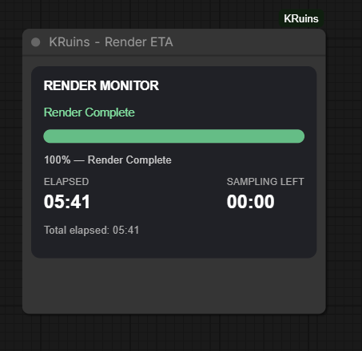

# KRuins — Render ETA

**Official Illustrated User Guide | KRuins ComfyUI Node Suite v1.0.0**

*Render Beyond Imagination*

## What Does Render ETA Do?

**KRuins — Render ETA** provides a live rendering progress monitor directly inside ComfyUI.

Instead of wondering how long a generation has been running or when it might finish, Render ETA displays useful timing and progress information as your workflow executes.

The node is especially helpful for longer image-generation batches and AI video workflows.

### Key Features

- Live rendering status
- Elapsed rendering time
- Sampling progress
- Estimated remaining time
- Visual progress indicator
- Render completion notification
- Automatic reset for the next render
- No workflow connections required

## 1. Understanding the Render Monitor

Render ETA is a standalone monitoring node.

Unlike image-saving or text-encoding nodes, it does not need to be connected to other nodes.

Simply add **KRuins — Render ETA** anywhere on your ComfyUI canvas.

The monitor observes supported rendering progress events and updates its display while a workflow runs.

This allows you to position it wherever it is easiest to see.

## 2. Live Rendering Progress

During an active render, the node displays progress information as it becomes available.

### Elapsed Time

Shows how long the current rendering operation has been running.

This is useful for comparing different workflows, model settings, resolutions, and hardware configurations.

### Sampling Progress

Displays the current sampling progress reported by ComfyUI.

When step information is available, the node can show progress through the sampling stage.

### Estimated Time Remaining

Render ETA estimates how much time remains based on the progress and timing information available.

This allows you to get an approximate idea of when the current operation may finish.

**Important:** The remaining-time estimate is not a guaranteed completion time. It can change during execution, especially when workflow stages take different amounts of time.

### Progress Indicator

The visual progress display makes it easy to check rendering activity at a glance without reading through ComfyUI's console output.

## 3. Render Completion

When ComfyUI reports that the render has finished, Render ETA updates its display to indicate completion.

The progress indicator reaches **100%**, and the monitor shows the completed rendering state.

This makes it easy to see that the workflow has finished even when the node is positioned away from your sampler or output nodes.

## 4. How to Add Render ETA

Adding Render ETA to an existing workflow is simple.

1. Open your workflow in ComfyUI.
2. Open the node search menu.
3. Search for **KRuins — Render ETA**.
4. Add the node anywhere on the canvas.
5. Start your render.

That's it!

**No input or output connections are required.**

Render ETA works independently of your workflow's image and video connections.

## 5. Automatic Reset

Render ETA is designed to be reused across multiple rendering operations.

When a new render begins, the monitor resets its previous progress information and begins tracking the new execution.

You do not need to delete and recreate the node between renders.

## 6. Using Render ETA with Image Generation

Render ETA can be included in image-generation workflows using:

- KSampler
- Compatible advanced samplers
- Image batches
- Wildcard Batch
- Save Image
- Other compatible ComfyUI workflow nodes

For example, when generating four images with Wildcard Batch, Render ETA provides a convenient way to monitor the ongoing render.

The node does not affect the prompts, conditioning, images, or sampler settings.

## 7. Using Render ETA with Video Generation

Render ETA is particularly useful for AI video workflows.

Video generation can involve longer sampling operations, making progress and estimated remaining time valuable.

The included **MiniMax H3 video workflow** demonstrates Render ETA alongside KRuins — Save Video.

Render ETA monitors the operation while Save Video handles the finished video output.

## 8. Understanding ETA Accuracy

Estimated time remaining is calculated from available rendering progress and timing information.

Several factors can affect accuracy:

**Model complexity**

Different models require different amounts of processing time.

**Resolution**

Higher-resolution outputs may take longer to process.

**Sampling steps**

Increasing the number of sampling steps generally increases the amount of sampling work.

**Workflow stages**

Model loading, sampling, decoding, and saving can require different amounts of time.

**Hardware performance**

GPU performance, available memory, and system workload can influence execution speed.

**Caching and optimizations**

Some optimization techniques may change how much work is performed during individual sampling steps.

Because these factors can vary during execution, the estimated remaining time should be treated as an approximation.

## 9. Practical Uses

Render ETA is useful for:

- Monitoring long-running image and video generations
- Comparing render durations between samplers
- Benchmarking different models
- Observing progress through image batches
- Checking whether a generation is still active
- Estimating when a render may finish
- Keeping a visible progress monitor on the canvas

## 10. Important Notes

- Render ETA is a monitoring tool and does not accelerate rendering.
- It does not modify images, videos, prompts, or conditioning.
- No wires or node connections are required.
- Progress reporting depends on the events available from ComfyUI.
- Remaining-time predictions are estimates and may change.
- Total elapsed time and sampling duration are not necessarily identical.
- A completed render does not guarantee that every downstream file was successfully saved; check your output nodes when needed.

## Download Example Workflows

Render ETA is included in both our FLUX image workflow and MiniMax H3 video workflow.

### FLUX Image Workflow

[Download FLUX Workflow JSON](../workflows/KRuins-FLUX-Image-Workflow.json)

[View FLUX Workflow PNG](../workflows/KRuins-FLUX-Image-Workflow.png)

Demonstrates Render ETA alongside Wildcard Batch, Show Text, and Save Image.

### MiniMax H3 Video Workflow

[Download H3 Workflow JSON](../workflows/KRuins-H3-Video-Workflow.json)

[View H3 Workflow PNG](../workflows/KRuins-H3-Video-Workflow.png)

Demonstrates Render ETA alongside Save Video in a video-generation workflow.

The example workflows require their referenced models and any additional third-party custom nodes.

---

## Other KRuins Guides

[KRuins — Wildcard Batch](WILDCARD-BATCH.md)

[KRuins — Show Text](SHOW-TEXT.md)

[KRuins — Save Image](SAVE-IMAGE.md)

[KRuins ComfyUI Node Suite — GitHub Repository](https://github.com/Rampart187/KRuins-ComfyUI-Node-Suite)

**KineticRuins.com — Render Beyond Imagination**
