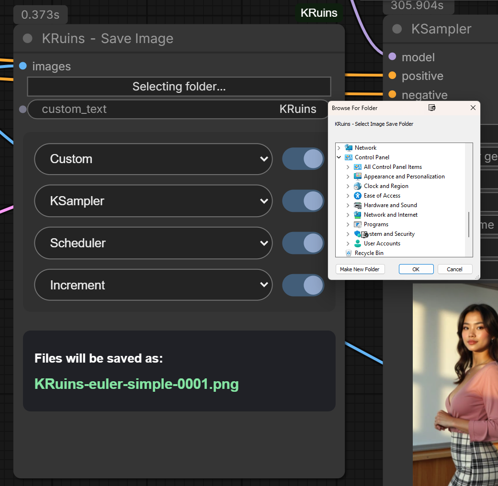
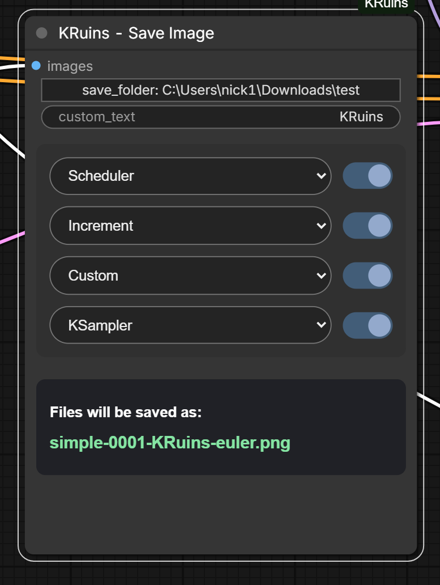
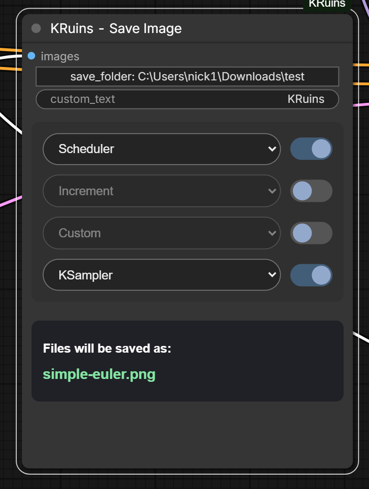
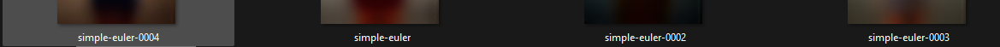

# KRuins — Save Image

**Official Illustrated User Guide | KRuins ComfyUI Node Suite v1.0.0**

*Render Beyond Imagination*

## What Does Save Image Do?

**KRuins — Save Image** is a customizable image-saving node for ComfyUI.

It saves generated images as PNG files and gives you control over where they are saved and how their filenames are constructed.

Features include:

- A graphical folder-selection dialog
- Four configurable filename positions
- Independent ON/OFF toggles for each filename position
- Automatic sampler and scheduler detection
- Custom filename text
- Incrementing filename numbers
- A live filename preview
- Automatic protection against overwriting existing files
- PNG metadata support

## 1. Choosing Your Save Folder

Click the **Select Folder** control to open the graphical folder picker.

Navigate to the folder where you want your generated images saved and confirm your selection.

The node then uses the selected directory as the save destination.

### Important

The native graphical folder picker currently requires Windows. Support for other operating systems has not yet been validated.

If you leave the custom destination empty, the node uses its configured default output location.

## 2. Understanding the Default Settings

Save Image includes a customizable filename builder with four positions.

Each position has a dropdown menu and an independent ON/OFF toggle.

The available filename components are:

| Component | Purpose |
|---|---|
| Custom | Uses the text entered in the Custom Text field |
| KSampler | Uses the detected sampler name |
| Scheduler | Uses the detected scheduler name |
| Increment | Adds a sequential filename number |
| None | Leaves that position without a filename component |

You can use these components in any order.

## 3. Customizing Filename Order

The four dropdown positions allow you to arrange filename components however you prefer.

For example, selecting:

1. Custom
2. KSampler
3. Scheduler
4. Increment

With Custom Text set to `KRuins`, sampler `euler`, and scheduler `normal`, might produce a filename similar to:

`KRuins-euler-normal-0001.png`

This is an illustrative filename. Exact formatting and numbering depend on the node's current settings.

You can rearrange the components at any time without changing your image-generation prompt.

## 4. Enabling and Disabling Filename Components

Each filename component has its own ON/OFF control.

This allows you to keep a dropdown selection while temporarily excluding that component from the generated filename.

For example:

**All enabled**

`KRuins-euler-normal-0001.png`

**Scheduler disabled**

`KRuins-euler-0001.png`

**Sampler and Scheduler disabled**

`KRuins-0001.png`

The live filename preview updates to reflect your current settings.

You do not need to run an image generation merely to inspect the intended filename.

## 5. Filename Preview

The **Filename Preview** display shows the filename that will be constructed from your selected components.

It helps you identify incorrect ordering, unnecessary components, or unwanted names before saving.

The filename preview is particularly useful when testing different combinations of Custom, KSampler, Scheduler, and Increment.

## 6. Automatic Sampler and Scheduler Detection

Save Image can detect sampler and scheduler selections from supported nodes in the connected ComfyUI workflow.

For example:

- KSampler: `euler`
- Scheduler: `normal`

When enabled in the filename builder, those detected names can be included automatically in the saved filename.

### Important

In workflows containing multiple samplers or schedulers, the detected values may not always represent the intended sampling stage.

Check the filename preview before relying on automatically detected values.

## 7. Automatic Overwrite Protection

Save Image includes protection against accidentally overwriting an existing image.

When the requested filename is already in use, the node generates an available filename rather than silently replacing the existing file.

This protection also applies when the **Increment** filename component is disabled.

That means you can choose a simpler filename while retaining protection against accidental replacement.

## 8. PNG Metadata

Save Image supports PNG metadata, allowing relevant ComfyUI workflow information to be retained in saved files where supported.

This can help with later reference, workflow inspection, and reproducibility.

The exact metadata retained depends on the information available during execution.

## 9. Connecting Save Image

Save Image accepts the generated image output from a compatible upstream node.

For a standard ComfyUI image workflow:

1. Add **KRuins — Save Image**.
2. Connect the decoded image output to the node's image input.
3. Choose your save destination.
4. Configure your preferred filename components.
5. Run the workflow.

Save Image saves the resulting PNG files using the configured destination and filename settings.

You can use it alongside **KRuins — Wildcard Batch**, **KRuins — Show Text**, and **KRuins — Render ETA**.

## 10. Practical Uses

Save Image is particularly helpful when:

- Comparing different samplers and schedulers
- Saving multiple generated images into organized folders
- Creating descriptive filenames for benchmarking
- Keeping files from separate projects organized
- Avoiding accidental overwrites during repeated runs
- Maintaining PNG files containing useful generation metadata

## 11. Important Notes

- The native folder-selection dialog currently requires Windows.
- Ensure ComfyUI has permission to write to the selected destination.
- Sampler and scheduler detection depends on supported workflow configurations.
- Automatic collision protection prevents normal filename conflicts but is not a substitute for maintaining backups.
- The filename builder changes the saved filename, not the generated image's content.

## Download the Example Workflow

The included FLUX example demonstrates Save Image alongside Wildcard Batch, Show Text, and Render ETA.

[Download FLUX Workflow JSON](../workflows/KRuins-FLUX-Image-Workflow.json)

[View FLUX Workflow PNG](../workflows/KRuins-FLUX-Image-Workflow.png)

The example workflow may require additional models and third-party ComfyUI nodes.

---

## Other KRuins Guides

[KRuins — Wildcard Batch](WILDCARD-BATCH.md)

[KRuins — Show Text](SHOW-TEXT.md)

[KRuins ComfyUI Node Suite — GitHub Repository](https://github.com/Rampart187/KRuins-ComfyUI-Node-Suite)

**KineticRuins.com — Render Beyond Imagination**
