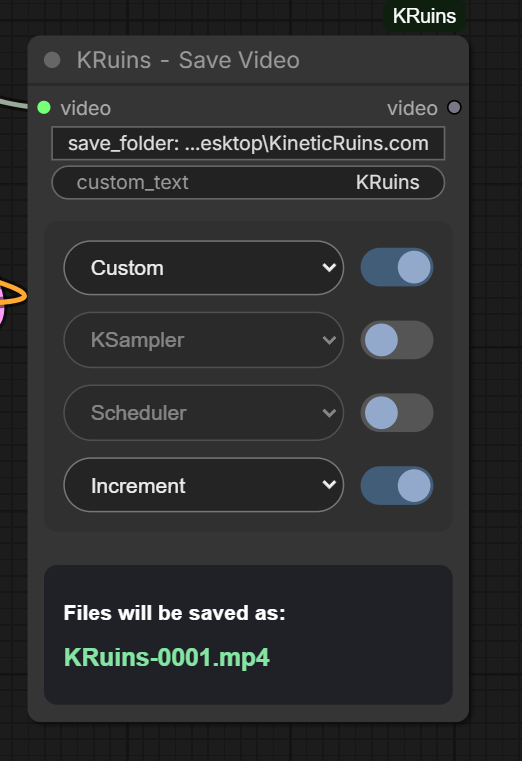

# KRuins — Save Video

**Official Illustrated User Guide | KRuins ComfyUI Node Suite v1.0.0**

*Render Beyond Imagination*

## What Does Save Video Do?

**KRuins — Save Video** is a customizable video-saving node for ComfyUI, designed to make saving and organizing AI-generated videos simple and convenient.

It accepts a ComfyUI **VIDEO** input, saves the finished video as an MP4 file, and provides an integrated video player directly inside the node.

Save Video also includes a flexible filename builder, allowing users to organize videos automatically by sampler, scheduler, custom text, and incrementing numbers.

### Key Features

- Save generated videos in MP4 format
- Integrated playable video preview
- Graphical destination-folder selection
- Four customizable filename positions
- Independent ON/OFF toggle for each position
- Custom filename text
- Automatic sampler and scheduler detection
- Incrementing filename numbers
- Live filename preview
- Automatic filename collision protection
- Support for ComfyUI's native VIDEO input and output
- MP4 metadata support

---

## 1. Save Video — Node Overview

The Save Video node combines video output, destination selection, filename configuration, and preview functionality into one convenient node.

Its main controls are designed to provide flexibility without requiring separate filename-building nodes.

### Video Input

Connect a compatible ComfyUI **VIDEO** output to the node's `video` input.

For example, the standard ComfyUI **Create Video** node can combine decoded video frames and audio into a VIDEO object.

That VIDEO output can then be connected directly to **KRuins — Save Video**.

### Video Output

Save Video also exposes a VIDEO output, allowing the video object to be passed to other compatible downstream nodes if needed.

---

## 2. Choosing Your Save Folder

Click the **Select Folder** control to open the graphical folder picker.

Navigate to your desired destination folder and confirm your selection.

Save Video will use that destination when writing the completed MP4 file.

### Native Windows Folder Picker

The graphical folder picker currently uses a native Windows dialog.

After you select a folder, the destination is retained in the node's settings.

Long directory paths may be shortened in the displayed folder control to keep the interface readable.

The complete destination remains available to the node when saving.

### Default Output Location

When a custom destination has not been selected, Save Video uses its configured ComfyUI output location.

### Important

- The graphical folder picker currently requires Windows.
- Other operating systems have not yet been fully validated.
- Ensure ComfyUI has permission to write files to your selected destination.
- Avoid saving to protected system directories.

---

## 3. Understanding the Filename Builder

Save Video provides four independently configurable filename positions.

Each position contains:

1. A dropdown menu for choosing a filename component.
2. An ON/OFF toggle for including or excluding that component.

You can combine the components in any order.

### Available Filename Components

| Component | Description |
|---|---|
| **Custom** | Uses the text entered in the Custom Text field |
| **KSampler** | Adds the detected sampler name |
| **Scheduler** | Adds the detected scheduler name |
| **Increment** | Adds a sequential filename number |
| **None** | Excludes a component from that position |

All four positions are optional and customizable.

You are not required to use a particular order.

---

## 4. Customizing Filename Options

The screenshot demonstrates how filename components can be configured to suit different projects.

For example, imagine the following settings:

| Position | Selection | Enabled |
|---|---|---|
| 1 | Custom | ON |
| 2 | KSampler | ON |
| 3 | Scheduler | ON |
| 4 | Increment | ON |

If the custom text is `KRuins`, the sampler is `euler`, and the scheduler is `normal`, a resulting filename might resemble:

`KRuins-euler-normal-0001.mp4`

This is an illustrative example. Exact formatting depends on the node's filename logic.

### Changing the Order

You can arrange the filename components however you prefer.

For example:

**Sampler first**

`euler-KRuins-normal-0001.mp4`

**Scheduler first**

`normal-euler-KRuins-0001.mp4`

**Custom and increment only**

`KRuins-0001.mp4`

These examples illustrate possible component arrangements, not mandatory settings.

---

## 5. ON/OFF Filename Toggles

Every filename position includes its own ON/OFF toggle.

This allows you to temporarily remove a component from the filename without changing the dropdown selection.

For example:

**All enabled**

`KRuins-euler-normal-0001.mp4`

**Scheduler disabled**

`KRuins-euler-0001.mp4`

**Sampler and Scheduler disabled**

`KRuins-0001.mp4`

The node constructs the filename using the currently enabled components.

This feature is useful when switching between benchmarking, production, and quick-test workflows.

---

## 6. Live Filename Preview

Save Video includes a **Filename Preview** display.

The preview updates as you change:

- Custom text
- Component selections
- Component ordering
- ON/OFF toggles

This allows you to inspect the intended filename before starting a render.

The preview is particularly useful when configuring long descriptive filenames or experimenting with different sampler and scheduler combinations.

---

## 7. Automatic Sampler and Scheduler Detection

Save Video can automatically obtain sampler and scheduler names from supported nodes in the workflow.

For example:

**Sampler:** `euler`

**Scheduler:** `normal`

When the matching filename components are enabled, the node can incorporate those values into the MP4 filename.

This is helpful when comparing renders made with different sampler or scheduler combinations.

### Important Note

If your workflow contains multiple sampler or scheduler nodes, automatic detection may not always identify the one you intended.

Check the filename preview when working with complex workflows.

---

## 8. Automatic Overwrite Protection

Save Video includes automatic filename collision protection.

If a file already exists with the requested filename, the node generates an available name rather than silently overwriting the existing video.

This helps protect previous renders when you run the same workflow repeatedly.

### Increment Can Be Disabled

You do not have to enable the **Increment** filename component to benefit from collision protection.

Even when Increment is switched OFF, Save Video is designed to avoid normal filename collisions.

This lets you keep simple filenames without accidentally replacing earlier results.

### Example

Suppose your first render saves as:

`KRuins-euler.mp4`

If you render again with the same settings and that filename already exists, Save Video will choose an available filename rather than replace the original.

The exact collision suffix depends on the implementation.

---

## 9. Integrated Playable Video Preview

One of Save Video's major features is its built-in video preview.

After a successful save, the node can display the completed video using ComfyUI's video preview interface.

The embedded player lets you inspect your finished result without immediately opening a separate media application.

### Playback Controls

Depending on your browser and ComfyUI frontend, the video player may provide:

- Play and pause
- Playback progress
- Timeline seeking
- Volume controls
- Video duration

This is especially convenient for short AI-generated video clips.

### Video and Audio

When the upstream VIDEO object contains audio, the saved MP4 can preserve that audio, subject to the available video encoding support.

The preview player may also allow you to listen to the saved video's audio.

Browser autoplay and audio playback restrictions can vary.

### Why This Matters

For example, after completing a MiniMax H3 render, you can:

1. Allow the workflow to finish.
2. Save the generated MP4 with KRuins Save Video.
3. Review the resulting video inside the Save Video node.
4. Check the motion, timing, framing, and audio.
5. Adjust your prompt or workflow settings before generating another version.

This keeps the testing process conveniently inside ComfyUI.

---

## 10. Previewing Videos Saved Outside ComfyUI's Output Folder

Save Video also supports previewing videos saved to a custom external destination.

When needed, the node uses a preview-accessible file within ComfyUI's temporary directory so that the frontend player can display the saved result.

The original video remains in your selected destination.

Depending on the filesystem and destination, this may involve a filesystem link or a separate temporary copy.

### Important

Temporary preview files may occupy additional disk space.

The video saved to your chosen destination is the primary output; preview files are used for display inside ComfyUI.

---

## 11. Connecting Save Video in ComfyUI

Save Video is designed to connect to nodes that produce a compatible ComfyUI VIDEO output.

### Basic Connection

`Create Video → KRuins Save Video`

A typical video workflow follows this sequence:

1. Generate or load video frames.
2. Generate or provide audio if desired.
3. Combine the frames and optional audio using **Create Video**.
4. Connect Create Video's **VIDEO** output to KRuins Save Video.
5. Configure the output folder and filename.
6. Run the workflow.
7. Review the completed MP4 using the integrated player.

Save Video handles the final saving stage.

It does not generate frames, create audio, or modify the underlying video-generation model.

---

## 12. MiniMax H3 Example Workflow

Our included MiniMax H3 workflow demonstrates Save Video working alongside **KRuins — Render ETA**.

The example is a family-friendly 10-second scene featuring a woman sharing food with a colorful animated bird in a sunny park.

The workflow demonstrates:

- MiniMax H3 image-to-video generation
- First-frame image conditioning
- Video duration and resolution settings
- Sampling and decoding
- Video and audio assembly
- Render ETA monitoring
- MP4 saving with KRuins Save Video

### Download the Workflow

[Download MiniMax H3 Workflow JSON](../workflows/KRuins-H3-Video-Workflow.json)

[View MiniMax H3 Workflow PNG](../workflows/KRuins-H3-Video-Workflow.png)

[View the Example First-Frame Image](../workflows/Picnic%20Smiles%20with%20a%20Blue%20Bird.png)

You can load the JSON into ComfyUI or drag the workflow PNG onto your canvas.

The workflow requires the referenced MiniMax H3 models and any additional third-party custom nodes to be installed.

---

## 13. Troubleshooting

### The Folder Picker Doesn't Open

The graphical picker currently relies on Windows.

Check that you're running on a supported Windows setup and that ComfyUI can launch the native folder-selection dialog.

If you're running ComfyUI on a remote machine, the folder picker operates in the environment where the ComfyUI server runs, not necessarily the computer displaying your browser.

### The Video Doesn't Save

Verify that:

- The VIDEO input is connected.
- The upstream node successfully produced a video.
- The selected destination exists.
- ComfyUI has permission to write to the destination.
- Your ComfyUI version supports the required VIDEO functionality.

### The Filename Doesn't Include a Sampler or Scheduler

Ensure the corresponding filename components are enabled.

Confirm your workflow contains supported sampler and scheduler nodes that the detection logic can identify.

### The Preview Doesn't Appear

Verify that the MP4 was saved successfully.

Check your ComfyUI version, browser video playback support, and the output or temporary preview location.

An MP4 that saves correctly can still encounter a frontend playback or preview-display issue.

### The Preview Has No Sound

Confirm that the VIDEO object contains audio and that the generated MP4 includes an audio track.

Also check the player's mute state, volume, and browser audio permissions.

---

## 14. Practical Uses

Save Video is especially helpful for:

- AI image-to-video generation
- MiniMax H3 workflows
- Short cinematic video tests
- Comparing sampler and scheduler configurations
- Organizing video benchmarks
- Keeping output filenames descriptive
- Reviewing videos directly inside ComfyUI
- Preventing accidental replacement of previous renders

---

## 15. Important Notes

- Save Video accepts a compatible ComfyUI VIDEO input.
- It saves MP4 files and provides a VIDEO output.
- The native graphical folder picker currently requires Windows.
- The node does not generate video or audio by itself.
- Automatic sampler and scheduler detection depends on the workflow configuration.
- Filename collision protection is designed to prevent normal accidental overwrites.
- The preview interface depends on supported ComfyUI and browser functionality.
- Video preview files may use additional temporary storage.
- Preserve important original renders and maintain regular backups.

---

## Other KRuins Guides

[KRuins — Wildcard Batch](WILDCARD-BATCH.md)

[KRuins — Show Text](SHOW-TEXT.md)

[KRuins — Save Image](SAVE-IMAGE.md)

[KRuins — Render ETA](RENDER-ETA.md)

[KRuins ComfyUI Node Suite — GitHub Repository](https://github.com/Rampart187/KRuins-ComfyUI-Node-Suite)

**KineticRuins.com — Render Beyond Imagination**
