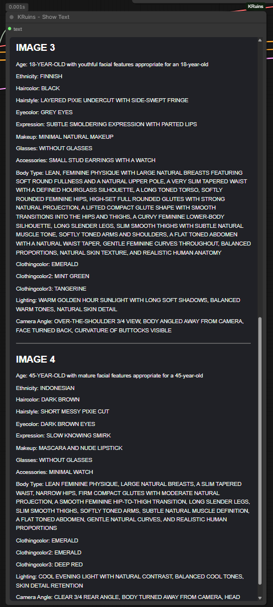

# KRuins — Show Text

**Official Illustrated User Guide | KRuins ComfyUI Node Suite v1.0.0**

*Render Beyond Imagination*

## What Does Show Text Do?

**KRuins — Show Text** displays only the actual wildcard values selected for each individual image in a generated batch, leaving out the rest of the prompt for fast and easy reference.

Instead of searching through a long prompt to determine which attributes were selected, you can see those selections immediately, organized by image number in a scrollable, resizable viewer.

Show Text works alongside **KRuins — Wildcard Batch**.

## How It Works

Wildcard Batch generates independent wildcard selections for each image.

Show Text receives the selected wildcard information and displays it in an organized format.

For example, if a prompt contains:

`A woman with __haircolor__ hair, __eyecolor__ eyes, wearing __clothingcolor__ clothing.`

Show Text might display:

```text
IMAGE 1

Haircolor: AUBURN
Eyecolor: GREEN
Clothingcolor: NAVY BLUE

IMAGE 2

Haircolor: BLONDE
Eyecolor: HAZEL
Clothingcolor: RED
```

The selections above are examples. Actual values depend on your wildcard files and seed settings.

**Important:** Show Text does not display the complete prompt. It displays the selected wildcard information, making it much easier to identify the variations used for each image.

## Screenshot — Individual Wildcard Selections


The screenshot demonstrates how Show Text displays the wildcard selections for an individual generated image.

Each selected value is labeled so you can quickly identify attributes such as age, hairstyle, hair color, eye color, clothing, and other wildcard categories.

## Screenshot — Reviewing Additional Images



When multiple images are generated, Show Text organizes the selections under their respective image numbers.

This allows you to compare the randomized attributes between images without examining the original prompt repeatedly.

## Connecting Show Text

Show Text is designed to work directly with **KRuins — Wildcard Batch**.

1. Add **KRuins — Wildcard Batch** to your ComfyUI workflow.
2. Add **KRuins — Show Text**.
3. Connect the **resolved_prompts** output from Wildcard Batch to the **text** input on Show Text.
4. Run the workflow.

After generation, Show Text displays the wildcard selections returned by Wildcard Batch.

### Example Workflow Connection


The screenshot shows Wildcard Batch generating the prompt variations and Show Text displaying the selected wildcard information.

## Scrollable and Resizable Display

Show Text includes a scrollable, resizable display.

**Scrollable viewer**

When a batch produces many wildcard selections, you can scroll through the results without expanding the node to an excessive size.

**Resizable node**

You can increase the node's dimensions to see more information at once or reduce its size to save space on the ComfyUI canvas.

**Image-number organization**

Selections are grouped by image number, making it easier to associate displayed values with the corresponding generated images.

## Why Use Show Text?

Show Text is particularly helpful when:

- Generating several images in a single batch.
- Using prompts with many wildcard categories.
- Comparing the selected attributes between images.
- Testing wildcard files and seed settings.
- Identifying which wildcard combinations produced a particular result.
- Keeping long prompts out of the way while reviewing selections.

It provides a quick reference without cluttering the display with the unchanged portions of the prompt.

## Important Notes

- Show Text displays information supplied by the connected Wildcard Batch node.
- Show Text does not generate wildcard values by itself.
- Show Text does not modify the generated image or its conditioning.
- A selected wildcard value does not guarantee that the image-generation model will reproduce that attribute exactly.
- The viewer is intended for examining wildcard selections rather than displaying the full prompt.

## Download the Example Workflow

Our FLUX example demonstrates Show Text working alongside Wildcard Batch, Render ETA, and Save Image.

[Download FLUX Workflow JSON](../workflows/KRuins-FLUX-Image-Workflow.json)

[View FLUX Workflow PNG](../workflows/KRuins-FLUX-Image-Workflow.png)

Load the JSON into ComfyUI or drag the workflow PNG onto the canvas. The workflow requires its referenced models and third-party extensions.

---

## Other KRuins Guides

[KRuins — Wildcard Batch](WILDCARD-BATCH.md)

[KRuins ComfyUI Node Suite — GitHub Repository](https://github.com/Rampart187/KRuins-ComfyUI-Node-Suite)

**KineticRuins.com — Render Beyond Imagination**
