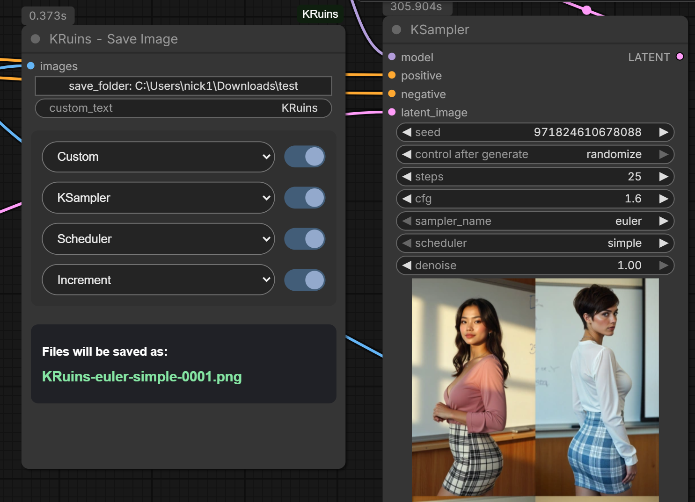
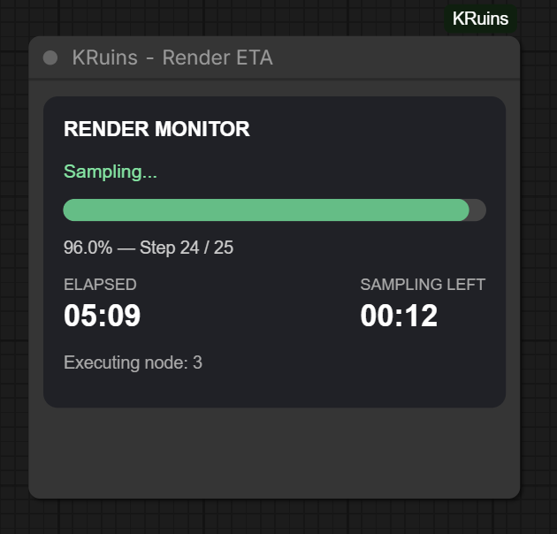
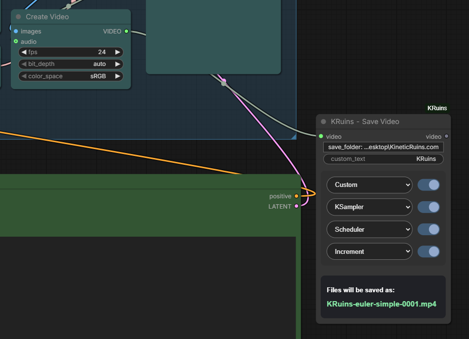

# KRuins ComfyUI Node Suite — User Guides

**Official Illustrated Documentation | Version 1.0.0**

*Render Beyond Imagination*

Welcome to the official documentation for **KRuins ComfyUI Node Suite**!

Our five illustrated guides explain how to use each custom node, with real screenshots, step-by-step instructions, configuration examples, and troubleshooting information.

Whether you're just getting started with ComfyUI or building advanced image and video workflows, you can jump directly to the features you need.

---

## Explore the Five Nodes

### 1. KRuins — Wildcard Batch


**A 3-in-1 wildcard generator and positive/negative CLIP text encoder.**

Generate independent wildcard prompt variations for every image in a batch, with seed controls and visual batch-size validation.

**[Read the Wildcard Batch Guide](WILDCARD-BATCH.md)**

### 2. KRuins — Show Text


**See only the wildcard selections for each generated image.**

Review the actual selected values without the rest of the original prompt, organized by image number in a scrollable, resizable viewer.

**[Read the Show Text Guide](SHOW-TEXT.md)**

### 3. KRuins — Save Image



**Save and organize PNG images with customizable filenames.**

Choose a destination folder, arrange filename components, enable or disable individual parts, and protect existing images from accidental overwriting.

**[Read the Save Image Guide](SAVE-IMAGE.md)**

### 4. KRuins — Render ETA



**Monitor your render's progress directly in ComfyUI.**

View elapsed time, sampling progress, estimated remaining time, and render completion without connecting any wires.

**[Read the Render ETA Guide](RENDER-ETA.md)**

### 5. KRuins — Save Video



**Save MP4 videos and preview them directly inside the node.**

Configure the destination, customize filename ordering, detect sampler and scheduler settings, and play back completed videos.

**[Read the Save Video Guide](SAVE-VIDEO.md)**

---

## Example Workflows

### FLUX Image Generation

A downloadable example demonstrating Wildcard Batch, Show Text, Render ETA, and Save Image.

- [Download FLUX Workflow JSON](../workflows/KRuins-FLUX-Image-Workflow.json)
- [View FLUX Workflow PNG](../workflows/KRuins-FLUX-Image-Workflow.png)

### MiniMax H3 Video Generation

A downloadable example demonstrating Render ETA and Save Video, with a family-friendly first-frame image.

- [Download MiniMax H3 Workflow JSON](../workflows/KRuins-H3-Video-Workflow.json)
- [View MiniMax H3 Workflow PNG](../workflows/KRuins-H3-Video-Workflow.png)
- [View H3 First-Frame Image](../workflows/Picnic%20Smiles%20with%20a%20Blue%20Bird.png)

Both example workflows may require additional models and third-party ComfyUI extensions.

---

## Installation

Install the published node suite using the ComfyUI Registry:

```bash
comfy node install kruins-node-suite
```

You can also find the package through supported versions of ComfyUI Manager or download the source code from GitHub.

[View the Official ComfyUI Registry Listing](https://registry.comfy.org/publishers/rampart187/kruins-node-suite)

[Visit the KRuins GitHub Repository](https://github.com/Rampart187/KRuins-ComfyUI-Node-Suite)

---

## Support and Feedback

Found a bug, have a question, or want to suggest an improvement?

[Report an Issue or Suggest a Feature](https://github.com/Rampart187/KRuins-ComfyUI-Node-Suite/issues)

For more resources, workflows, and tutorials, visit [KineticRuins.com](https://kineticruins.com).

---

**KRuins ComfyUI Node Suite v1.0.0**

*Render Beyond Imagination.*
