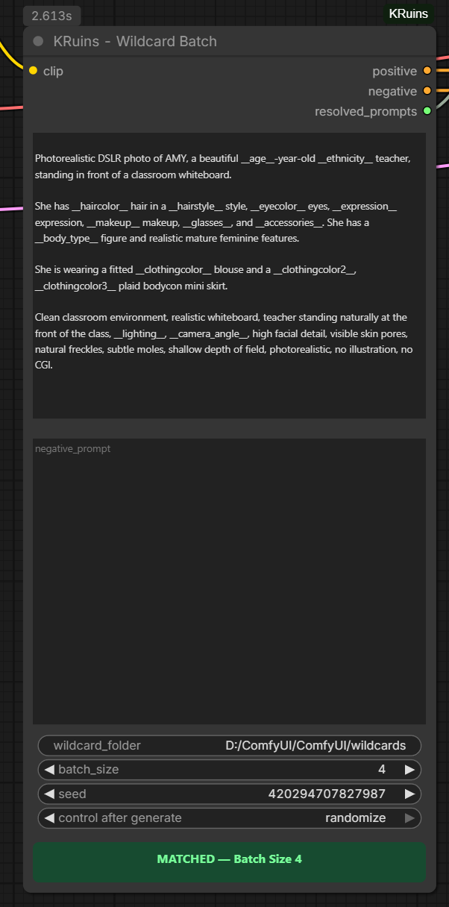

# KRuins ComfyUI Node Suite — Illustrated User Guide

**Render Beyond Imagination**

Welcome to the official user guide for **KRuins ComfyUI Node Suite v1.0.0**.

This guide explains how to use the five KRuins nodes, with screenshots, practical examples, and instructions for connecting them in ComfyUI.

## Included Nodes

1. **KRuins — Wildcard Batch**
2. **KRuins — Show Text**
3. **KRuins — Save Image**
4. **KRuins — Render ETA**
5. **KRuins — Save Video**

---

# 1. KRuins — Wildcard Batch

## What Does Wildcard Batch Do?

**KRuins — Wildcard Batch** is a three-in-one node combining:

- **Wildcard prompt generation** — Randomly selects values from wildcard text files and creates an independent prompt variation for each image in a batch.
- **Positive CLIP text encoding** — Encodes the generated positive prompts directly into conditioning.
- **Negative CLIP text encoding** — Encodes the generated negative prompts directly into conditioning.

This eliminates the need to add separate positive and negative CLIP Text Encode nodes for a standard supported workflow.

Instead of repeating the same prompt for every image, Wildcard Batch can create a different combination of selected attributes for each image.

## Example: One Prompt, Multiple Variations

Suppose your positive prompt contains:

`A portrait of a woman with __haircolor__ hair, __eyecolor__ eyes, wearing __clothingcolor__ clothing.`

Your wildcard text files might contain:

**haircolor.txt**
- Auburn
- Blonde
- Black
- Chestnut brown

**eyecolor.txt**
- Blue
- Green
- Brown
- Hazel

**clothingcolor.txt**
- Red
- Navy blue
- White
- Emerald green

With a batch size of four, the node independently selects wildcard values for each image.

Possible results:

| Image | Hair | Eyes | Clothing |
|---|---|---|---|
| Image 1 | Auburn | Green | Navy blue |
| Image 2 | Blonde | Hazel | Red |
| Image 3 | Chestnut brown | Blue | White |
| Image 4 | Black | Brown | Emerald green |

These are example combinations, not guaranteed results. The generated image still depends on the model's interpretation of each prompt.

## Understanding the Node



The positive and negative prompt fields work like normal text prompts, but you can insert wildcard references wherever you want random selections.

A wildcard reference uses the filename surrounded by double underscores:

`__haircolor__`

This tells the node to select a value from `haircolor.txt` in the configured wildcard folder.

## Connecting Wildcard Batch


Connect the node to your workflow as follows:

**CLIP Input**

Connect the appropriate CLIP output from your model's CLIP loader.

**Positive Conditioning Output**

Connect the Wildcard Batch positive conditioning output to the positive conditioning input of your sampler or compatible guider.

**Negative Conditioning Output**

Connect the Wildcard Batch negative conditioning output to the negative conditioning input of a compatible sampler, when required.

**Wildcard Text Output**

Connect the text output to **KRuins — Show Text** to display the selected wildcard values for each image.

**Batch Size**

Set the node's batch size to match the number of images you intend to generate.

The included FLUX example workflow demonstrates the actual connections.

## Setting the Wildcard Folder

Enter the full path to the folder containing your wildcard `.txt` files.

Example:

`D:\Wildcards`

Each wildcard file contains a collection of possible values, typically one per line.

For example, `haircolor.txt` could contain:

```text
black
brown
blonde
auburn
silver
```

Then use `__haircolor__` anywhere in your prompt.

If you're new to wildcard files, we'll also provide a separate beginner-friendly wildcard guide and downloadable example pack.

## Independent Variations for Every Image

Wildcard Batch does not simply generate one randomized prompt and apply it to the entire batch.

It independently resolves the wildcard references for each image.

For example, a batch of four images can receive four different prompt variations, each with its own selected hair color, hairstyle, eye color, clothing color, lighting, and other attributes.

Because selections are random, individual values may occasionally repeat across images.

## Seed Controls


The node includes seed controls to manage wildcard selection.

Supported seed behavior includes:

| Mode | Behavior |
|---|---|
| Fixed | Keeps the current seed for repeatable selections |
| Increment | Increases the seed after generation |
| Decrement | Decreases the seed after generation |
| Randomize | Selects a new seed after generation |

A fixed seed helps reproduce wildcard selections when the wildcard files, prompt, and settings have not changed.

Note that wildcard selection seeds and your sampler's image-generation seed serve different purposes.

## Batch-Size Validation

Wildcard Batch includes a visual batch-size checker to help prevent mismatches between generated prompt variations and the connected latent batch.

### Matched Batch Size


When the Wildcard Batch size matches the connected Empty Latent batch size, the indicator displays **MATCHED** in green.

For example:

- Wildcard Batch: 4
- Empty Latent batch size: 4
- Result: **MATCHED**

### Mismatched Batch Size


When the two batch sizes differ, the indicator displays **MISMATCH** in red.

For example:

- Wildcard Batch: 4
- Empty Latent batch size: 2
- Result: **MISMATCH**

Correct the batch sizes before rendering to ensure the workflow is configured as intended.

## Recommended Companion Node: Show Text

KRuins — Show Text is especially useful when working with Wildcard Batch.

Rather than displaying the entire positive prompt, Show Text displays **only the wildcard values actually selected for each image**, organized by image number.

That makes it easier to review generated variations without reading through long prompts.

The next section of this guide covers Show Text in detail.

## Download the Example Workflow

Our FLUX example includes Wildcard Batch, Show Text, Render ETA, and Save Image.

- [Download FLUX Workflow JSON](../workflows/KRuins-FLUX-Image-Workflow.json)
- [View FLUX Workflow PNG](../workflows/KRuins-FLUX-Image-Workflow.png)

You can load the JSON into ComfyUI or drag the workflow PNG directly onto the ComfyUI canvas.

The workflow requires its referenced models and any third-party custom nodes to be installed.

---

**Next section: KRuins — Show Text**

[Back to KRuins GitHub Repository](https://github.com/Rampart187/KRuins-ComfyUI-Node-Suite)

**KineticRuins.com — Render Beyond Imagination**
