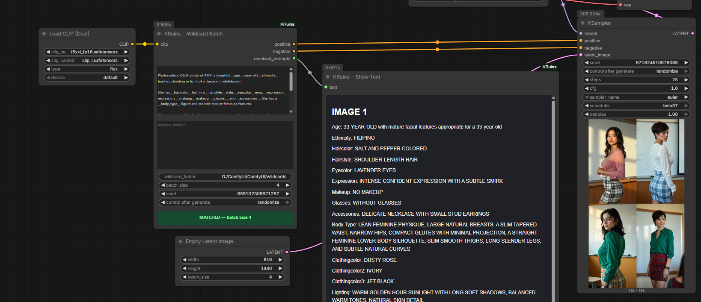
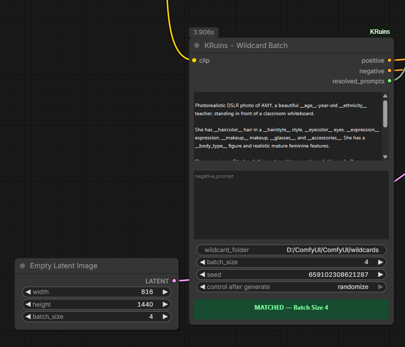
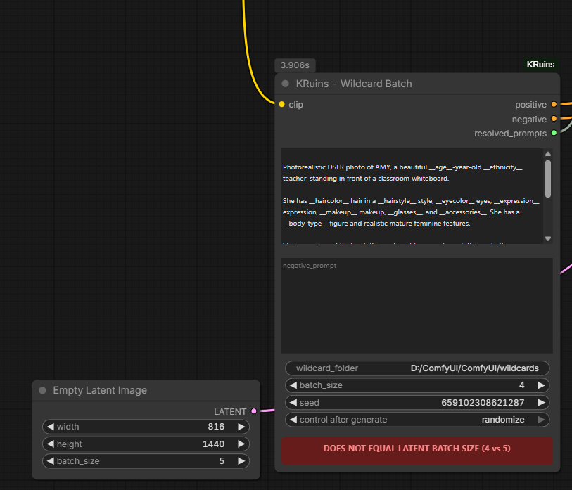
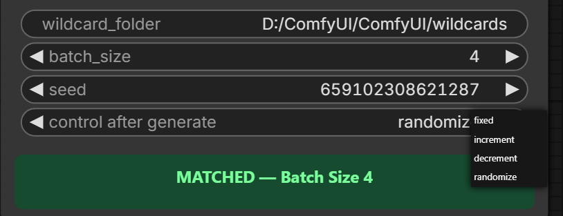
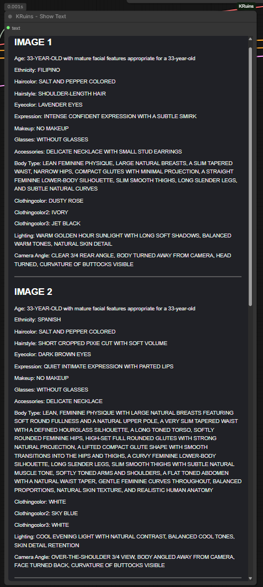

# Beginner's Guide to Wildcards in ComfyUI

**KRuins ComfyUI Node Suite · Free family-friendly tutorial**

*Render Beyond Imagination*

## What is a wildcard?

A wildcard is a placeholder in a text prompt that tells **KRuins — Wildcard Batch** to choose a line from a matching text file. It makes it easy to generate variations without rewriting the entire prompt.

For example, if `haircolor.txt` contains:

```text
black
brown
blonde
auburn
```

Then a prompt such as:

```text
A portrait of an adult person with __haircolor__ hair.
```

can resolve to *black*, *brown*, *blonde*, or *auburn* hair. A given value can be selected more than once across different images.

## 1. Download the free family-friendly pack

[**Download KRuins Wildcard Pack v1.2 (ZIP)**](../KRuins-Wildcard-Pack-v1.2-Family-Friendly.zip)

The ZIP contains a top-level archive folder (internally named `KRuins-Wildcard-Pack-v1.1`) with documentation and a **`Wildcards`** subfolder holding the `.txt` files. **The name of the inner folder does not need to match the ZIP version.**

## 2. Extract the files

Right-click the ZIP in Windows and choose **Extract All**. Open the extracted folder until you find the folder named **`Wildcards`** that directly contains files such as `haircolor.txt`, `lighting.txt`, and `accessories.txt`.

You can keep this folder wherever you like, for example:

```text
D:\Wildcards\
    haircolor.txt
    lighting.txt
    accessories.txt
```

The important part is selecting the **folder that directly contains the TXT files**, not the ZIP file or its enclosing directory.

## 3. Use the correct wildcard syntax

Type the filename **without `.txt`**, wrapped in double underscores:

| File | Type in your prompt |
|---|---|
| `haircolor.txt` | `__haircolor__` |
| `lighting.txt` | `__lighting__` |
| `accessories.txt` | `__accessories__` |

For example:

```text
Photorealistic portrait of an adult person with __haircolor__ hair.
Lighting: __lighting__. Accessories: __accessories__.
```

**Use the exact file stem** from your own pack; these are examples of files that are included. Don't invent placeholder names unless you also create matching `.txt` files.

## 4. Configure KRuins — Wildcard Batch

1. Add **KRuins — Wildcard Batch** to your ComfyUI workflow.
2. Connect an appropriate **CLIP** model output to the node's CLIP input.
3. Enter the full folder path in **`wildcard_folder`**, such as `D:\Wildcards`.
4. Paste your prompt containing `__filename__` references into the positive prompt field. Add a negative prompt if your workflow uses one.
5. Set **`batch_size`** to the number of images you want to generate.
6. Match the **Empty Latent Image** batch size to Wildcard Batch's batch size.
7. Connect the positive and negative conditioning outputs to the appropriate sampler or guider inputs for your model. Connect the `resolved_prompts` text output to **KRuins — Show Text** if you'd like to inspect the chosen values.
8. Run your workflow.



## 5. Read the batch-size indicator

If Wildcard Batch and the connected latent image batch sizes match, the indicator displays **MATCHED** in green. If they differ, it displays **MISMATCH** in red.





## 6. Understand the seed controls

- **Fixed:** Keeps the wildcard selection seed unchanged so you can repeat selections with the same files and prompt.
- **Increment / Decrement:** Changes the wildcard selection seed after generation.
- **Randomize:** Picks a new seed after generation.

The wildcard selection seed is different from the sampler seed used to generate image noise.



## 7. Check the chosen values with Show Text

**KRuins — Show Text** reports **only the wildcard values selected** for each image, not the unchanged text of the whole prompt. Each result is labeled by image number.



The model still interprets the resulting prompt, so not every selected attribute is guaranteed to appear in the image.

## 8. Make your own wildcard file

Create a plain UTF-8 text file named, for example, `weather.txt`. Add one option per line:

```text
sunny
cloudy
misty
light rain
```

Save it inside your selected `Wildcards` folder, then use `__weather__` in your prompt.

For clarity, prefer nonempty lines and descriptive, family-friendly options. Avoid naming two files identically in the same folder.

## 9. Common problems

**The wildcard isn't replaced:** Check that the `.txt` file exists, the folder path points directly to it, and the token's name matches the filename exactly.

**Every image looks similar:** Randomly selected options may repeat. Make sure the referenced files contain enough variation, and remember that the model may not strictly follow every selected value.

**The batch indicator is red:** Make the Wildcard Batch and Empty Latent batch sizes match.

**Nothing appears in Show Text:** Make sure Wildcard Batch's `resolved_prompts` output is connected to Show Text's `text` input, and run the workflow.

## Learn more

- [Full Wildcard Batch Illustrated Guide](WILDCARD-BATCH.md)
- [Show Text Illustrated Guide](SHOW-TEXT.md)
- [FLUX Example Workflow JSON](../workflows/KRuins-FLUX-Image-Workflow.json)
- [Back to KRuins Resource Center](../index.html#wildcards)

**KRuins ComfyUI Node Suite — Render Beyond Imagination**
